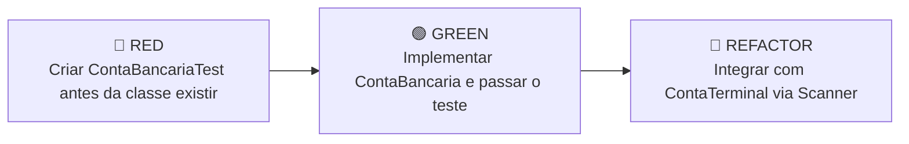

<div align="center">

# 💳 ContaBanco

[](https://www.java.com/)
[](https://web.dio.me/)
[](#-desenvolvimento-guiado-por-testes-tdd)
[](#)

<p align="center">
  <strong>Simulador interativo de abertura de conta bancária via terminal, desenvolvido com foco em Orientação a Objetos e TDD.</strong>
</p>

---

</div>

## 📖 Sobre o Projeto (About)

Este projeto é um teste prático desenvolvido como parte do curso de **Java** da **[DIO.me](https://web.dio.me/)** (*Digital Innovation One*). 

O desafio propõe a criação de uma aplicação simples e educativa em Java puro (sem uso de gerenciadores de dependência como Maven ou Gradle), cujo objetivo é capturar os dados de uma nova conta bancária via linha de comando (`Scanner`) e emitir uma mensagem de confirmação com saldo disponível para saque.

---

## 🎯 Conceitos e Metodologias Aplicadas

- **Orientação a Objetos (POO):** Separação de responsabilidades entre o modelo de domínio ([ContaBancaria](file:///c:/Users/HugoNorte/Documents/sandbox/java/dio-conta/dio-conta/src/ContaBancaria.java)) e a camada de interface/entrada de dados ([ContaTerminal](file:///c:/Users/HugoNorte/Documents/sandbox/java/dio-conta/dio-conta/src/ContaTerminal.java)).
- **TDD (Test-Driven Development):** Construção da lógica de negócio orientada por testes automatizados ([ContaBancariaTest](file:///c:/Users/HugoNorte/Documents/sandbox/java/dio-conta/dio-conta/src/ContaBancariaTest.java)).
- **I/O no Terminal com `Scanner`:** Tratamento de buffers, entrada de números inteiros, textos compostos e decimais com formatação americana (`Locale.US`).

---

## 🔁 Desenvolvimento Guiado por Testes (TDD)

A regra de negócio da mensagem de boas-vindas foi concebida utilizando o ciclo clássico do TDD:



1. **🔴 RED:** Criação de `ContaBancariaTest.java` validando atributos e a mensagem gerada (falha de compilação intencional).
2. **🟢 GREEN:** Criação de `ContaBancaria.java` com os atributos `numero`, `agencia`, `nomeCliente` e `saldo`, satisfazendo a validação.
3. **🔵 REFACTOR:** Conexão limpa com a classe executável `ContaTerminal.java` para entrada de dados interativa.

---

## 📂 Estrutura do Projeto

```plaintext
dio-conta/
├── .vscode/
│   └── settings.json         # Configuração de build e classpath do VS Code
├── bin/                      # Saída dos arquivos compilados (.class)
├── lib/                      # Diretório reservado para dependências externas
├── src/
│   ├── ContaBancaria.java     # Classe de domínio com os atributos e regras de negócio
│   ├── ContaBancariaTest.java # Suite de teste automatizado (TDD)
│   └── ContaTerminal.java     # Classe principal com entrada e saída via terminal
├── .gitignore                # Regras de exclusão de binários e configurações locais
└── README.md                 # Documentação oficial do projeto
```

---

## 💻 Exemplo de Execução

Ao iniciar o programa pelo terminal, os dados da conta são solicitados passo a passo:

```text
Por favor, digite o número da Agência (Ex: 067-8):
067-8
Por favor, digite o número da Conta (Ex: 1021):
1021
Por favor, digite o Nome do Cliente:
MARIO ANDRADE
Por favor, digite o Saldo inicial (Ex: 237.48):
237.48

Olá MARIO ANDRADE, obrigado por criar uma conta em nosso banco, sua agência é 067-8, conta 1021 e seu saldo 237.48 já está disponível para saque.
```

---

## 🚀 Como Executar

### Pré-requisitos
- **Java JDK** (versão 17 ou superior recomendada)

### 1. Clonar o repositório
```bash
git clone https://github.com/hugonorte/dio-conta.git
cd dio-conta
```

### 2. Rodar os Testes (TDD)
```bash
javac -d bin src/ContaBancaria.java src/ContaBancariaTest.java
java -cp bin ContaBancariaTest
```
> Saída esperada: `🟢 TESTE PASSOU: Mensagem gerada com sucesso!`

### 3. Executar o Programa Principal
```bash
javac -d bin src/ContaBancaria.java src/ContaTerminal.java
java -cp bin ContaTerminal
```

---

<div align="center">
  <sub>Desenvolvido com dedicação para a formação Java na <a href="https://web.dio.me/">DIO.me</a>.</sub>
</div>
